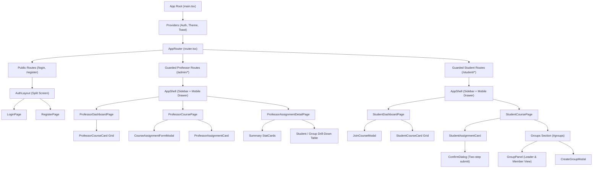

# ClassDesk

ClassDesk is a responsive, course-centric Assignment & Submission Management Dashboard designed for university workflows. Built as a zero-backend, client-side web application, ClassDesk simulates an asynchronous REST API, JWT authentication session, and database layer inside the browser with production-grade architectural rigor.

- **Live Deployment:** [https://classdesk-one.vercel.app/](https://classdesk-one.vercel.app/)

---

## 1. Tech Stack

- **Framework:** [React 19](https://react.dev/) + [TypeScript 5](https://www.typescriptlang.org/)
- **Build Tool:** [Vite 6](https://vite.dev/)
- **Styling:** [Tailwind CSS v4](https://tailwindcss.com/) with CSS custom property tokens
- **Icons:** [Lucide React](https://lucide.dev/)
- **Testing:** [Vitest 5](https://vitest.dev/) + [React Testing Library](https://testing-library.com/) + `@testing-library/user-event`
- **Routing:** [React Router v7](https://reactrouter.com/) (BrowserRouter with route guards and SPA rewrites)
- **Deployment:** [Vercel](https://vercel.com/) with single-page app rewrites (`vercel.json`)

---

## 2. Setup & Installation

All application code lives in the `/frontend` directory:

```bash
# Navigate to the frontend directory
cd frontend

# Install dependencies
npm install

# Start local development server (http://localhost:5173)
npm run dev

# Run full test suite with Vitest
npm run test:run

# Build production bundle with TypeScript checks
npm run build

# Preview the production build locally
npm run preview
```

---

## 3. Demo Accounts & Credentials

All demo accounts share the password: `demo1234`. The database is automatically seeded into `localStorage` upon initial visit or can be reset anytime using the **"Reset demo data"** button on the Login page.

| Role / Persona | Name | Email | Password | Context & Demo Purpose |
| :--- | :--- | :--- | :--- | :--- |
| **Professor (Instructor)** | Prof. Meera Iyer | `meera.iyer@classdesk.edu` | `demo1234` | Primary professor. Teaches *WEB101* and *HCI210*. Creates and manages assignments, tracks submissions, and views group rosters. |
| **Professor (Co-Instructor)** | Prof. Arjun Mehta | `arjun.mehta@classdesk.edu` | `demo1234` | Teaches *DSA201* and *OSY301*. Demonstrates cross-course isolation and course ownership permissions. |
| **Student: Group Leader** | Aarav Sharma | `aarav.sharma@classdesk.edu` | `demo1234` | **Leader** of *Team Alpha* in WEB101. Has authority to acknowledge group deliverables; also has completed individual assignments. |
| **Student: Group Member** | Diya Patel | `diya.patel@classdesk.edu` | `demo1234` | **Member** of *Team Alpha* in WEB101. Demonstrates the non-leader member view: disabled group acknowledge button with info note, and individual submission flow. |
| **Student: No Group** | Aarav Sharma | `aarav.sharma@classdesk.edu` | `demo1234` | In course *DSA201*, Aarav has **no group**. Demonstrates the "Create or join a group" call-to-action on group cards, linking directly to `#groups`. |
| **Student: Unassigned / New** | Kabir Singh | `kabir.singh@classdesk.edu` | `demo1234` | In course *WEB101*, demonstrates applicable-only filtering: excluded from assignments targeted to selected students. |

> [!TIP]
> Demo accounts are conveniently listed as quick-fill cards directly on the `/login` screen for 1-click credential filling.

---

## 4. Design & Architecture Decisions

### Design System & Theme Tokens
- **Semantic CSS Tokens:** Built using Tailwind CSS v4 custom property tokens (`--bg`, `--surface`, `--surface-2`, `--fg`, `--muted`, `--accent`, `--line`, `--danger`, `--warning`, `--success`).
- **Dark & Light Modes:** Seamless zero-flicker theme switching with manual toggle and automatic `prefers-color-scheme` OS detection, persisted in `localStorage`.
- **Split-Screen Auth Shell:** A responsive split-screen layout (`AuthLayout`) with the active form on the left and a full-bleed university photography panel on the right (collapsing gracefully on mobile).
- **Responsive Layout Shell (`AppShell`):** Fixed desktop sidebar (260px) and an accessible mobile slide-in navigation drawer with backdrop blur, keyboard dismissal (Esc), and touch targets of $\ge 44\text{px}$.
- **Card-Centric Architecture:** Course cards and assignment cards feature header covers, urgency labels, progress bars, and high-contrast badges.

### Accessibility (a11y) & Motion-Safe Transitions
- **WCAG 2.1 AA Compliance:** Minimum 4.5:1 color contrast for normal text and 3:1 for interactive elements.
- **Never Color Alone:** Due dates and status states always pair color with unambiguous text and distinct icons (e.g. `AlertTriangle` for overdue, `Clock` for due soon, `CheckCircle2` for done).
- **Focus Management:** Modals trap focus with Return-focus-on-close, form errors auto-focus the first invalid field, and skip-to-content links are present.
- **`motion-safe:` Animations:** Every hover scale, slide-in drawer, and modal transition is wrapped in `motion-safe:` to respect the user's `prefers-reduced-motion` settings.

---

## 5. Mock API & Persistence Architecture

ClassDesk operates entirely client-side without an external backend while strictly maintaining RESTful patterns:

1. **Storage Layer (`src/services/storage.ts`):**
   - Versioned schema (`SCHEMA_VERSION = 2`) stored under keys prefixed with `classdesk_v2_*`.
   - Collections for `users`, `courses`, `enrollments`, `groups`, `groupAcks`, `assignments`, and `submissions`.
   - Safe serialization with in-memory fallback cache when `localStorage` is disabled or full.
2. **Asynchronous Mock API (`src/services/mockApi.ts` & `src/services/api/*`):**
   - Barrel export pattern providing asynchronous functions returning typed Promises.
   - Realistic network simulation with configurable latency (100–300ms) and toggleable network errors via `?simulateErrors=true`.
3. **Simulated JWT Authentication (`src/services/auth/token.ts`):**
   - Three-part base64Url simulated JWT (`header.payload.signature`) with 8-hour expiry.
   - Survives browser reloads, validates expiration on tab visibility, and displays a dismissible session notice when expired.

---

## 6. Folder Structure

```
frontend/
├── public/                 # Static assets and favicon
├── src/
│   ├── app/                # Application entry, router, and route guards
│   │   ├── guards.tsx      # RequireAuth, RequireRole, PublicOnlyRoute
│   │   └── router.tsx      # React Router route table
│   ├── components/         # Reusable presentation components
│   │   ├── assignments/    # StudentAssignmentCard, ProfessorAssignmentCard, Modals
│   │   ├── courses/        # StudentCourseCard, ProfessorCourseCard, JoinCodeChip
│   │   ├── layout/         # AppShell, TopNav, PageHeader
│   │   └── ui/             # Button, Badge, Modal, ConfirmDialog, ProgressBar, Toast
│   ├── context/            # React context providers (AuthContext, ThemeContext, ToastContext)
│   ├── data/               # Seed data generator and sample datasets
│   ├── features/           # Feature pages and page-level hooks
│   │   ├── admin/          # ProfessorDashboard, ProfessorCourse, ProfessorAssignmentDetail
│   │   ├── auth/           # LoginPage, RegisterPage, AuthLayout
│   │   ├── common/         # NotFoundPage
│   │   └── student/        # StudentDashboard, StudentCoursePage, StudentCalendarPage
│   ├── hooks/              # Custom React hooks (useDebounce, usePageTitle, useEscapeKey)
│   ├── services/           # Data services and mock backend
│   │   ├── api/            # Modular domain APIs (courses, assignments, groups, auth)
│   │   ├── auth/           # Token generation and validation
│   │   ├── mockApi.ts      # Public API barrel export
│   │   └── storage.ts      # Schema-versioned localStorage manager
│   ├── tests/              # Automated test suites
│   │   ├── integration/    # Feature integration workflows
│   │   └── unit/           # Validation, token, filter, and API unit tests
│   ├── types/              # TypeScript interfaces and domain models
│   ├── utils/              # Pure utilities (dates, validation, filters, stats, cn)
│   ├── index.css           # Tailwind CSS v4 directives and CSS variables
│   └── main.tsx            # React application bootstrap
├── vercel.json             # Single Page Application rewrite rules
├── vite.config.ts          # Vite configuration
└── package.json            # Scripts and dependencies
```

---

## 7. Component Structure



---

## 8. Screenshots & GIFs

*(Placeholders for UI walkthrough documentation)*

| Screen | Preview Placeholder | Description |
| :--- | :--- | :--- |
| **Login & Demo Accounts** | `docs/screenshots/01-login-split.png` | Split-screen login with 1-click demo account cards. |
| **Professor Dashboard** | `docs/screenshots/02-professor-dashboard.png` | Course cards with join codes, enrolled counts, and creation modal. |
| **Professor Course Deliverables** | `docs/screenshots/03-professor-course-assignments.png` | Assignment management with submission progress bars and status filters. |
| **Assignment Tracking Drill-down** | `docs/screenshots/04-professor-assignment-tracking.png` | Granular per-student and group submission roster with live search. |
| **Student Dashboard** | `docs/screenshots/05-student-dashboard.png` | Enrolled courses with overall progress indicators and join code modal. |
| **Student Deliverables & Groups** | `docs/screenshots/06-student-course-page.png` | Applicable-only assignment cards, two-step submit dialog, and group panel. |
| **Mobile Drawer & Dark Mode** | `docs/screenshots/07-mobile-dark-mode.png` | Fully responsive navigation drawer and high-contrast dark theme. |
